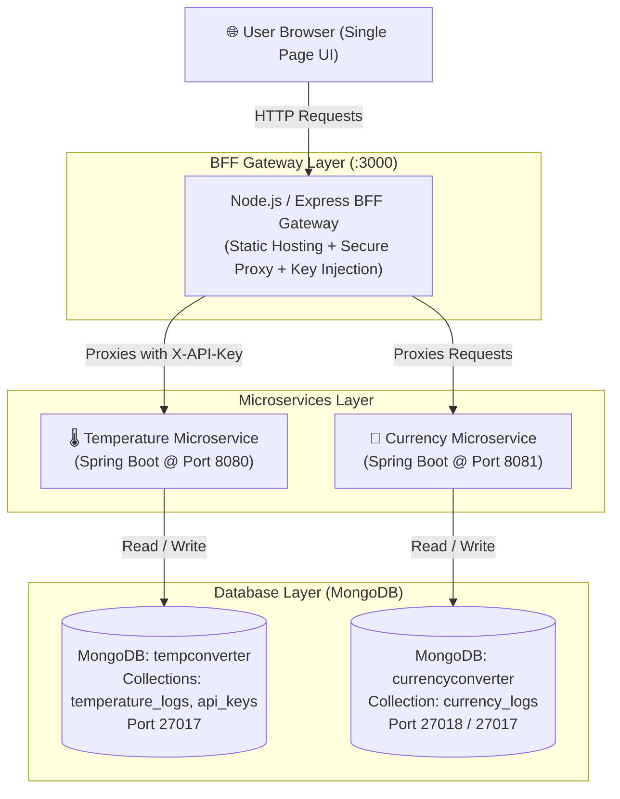

# 🌐 Multi-Converter Microservices Monorepo


A production-ready, distributed microservices monorepo designed for high-accuracy **Currency** and **Temperature** conversions. Built with a decoupled **Backend-For-Frontend (BFF)** architecture, it features enterprise-grade **API Key security**, real-time **safety check warnings**, and persistent **MongoDB audit logging** with server-side date and unit filtering.

---

## 📑 Table of Contents

- [Architectural Overview](#-architectural-overview)
- [Key Features](#-key-features)
- [Tech Stack](#-tech-stack)
- [Project Directory Structure](#-project-directory-structure)
- [API Reference](#-api-reference)
  - [1. BFF Gateway Endpoints (`:3000`)](#1-bff-gateway-endpoints-port-3000)
  - [2. Temperature Microservice (`:8080`)](#2-temperature-microservice-port-8080)
  - [3. Currency Microservice (`:8081`)](#3-currency-microservice-port-8081)
  - [4. API Key Management (`:8080` / `:3000`)](#4-api-key-management-endpoints)
- [Getting Started](#-getting-started)
  - [Option 1: Quickstart with Docker Compose (Recommended)](#option-1-quickstart-with-docker-compose-recommended)
  - [Option 2: Manual Local Development Setup](#option-2-manual-local-development-setup)
- [Environment Variables](#-environment-variables)
- [Testing with Postman](#-testing-with-postman)
- [Security Architecture](#-security-architecture)

---

## 🏗️ Architectural Overview

The project uses the **Backend-For-Frontend (BFF)** pattern. The client browser communicates strictly with the Express.js BFF Gateway. The BFF hides internal network topologies, handles CORS, and injects confidential credentials (`X-API-Key`) server-to-server before calling upstream Spring Boot services.



---

## ✨ Key Features

### 1. 💱 Currency Converter
- Bidirectional conversion between **USD (United States Dollar)** and **LKR (Sri Lankan Rupee)**.
- Base rate: `1 USD = 300.00 LKR`.
- Every conversion event records input amount, output amount, applied exchange rate, and timestamp.

### 2. 🌡️ Temperature Converter & Safety Alert System
- Bidirectional conversion between **Celsius (°C)** and **Fahrenheit (°F)** with absolute zero bounds validation ($\ge -273.15^\circ\text{C}$ / $\ge -459.67^\circ\text{F}$).
- **Automated Safety Analysis**:
  - `Dangerous Heat Warning` ($\ge 38^\circ\text{C}$)
  - `Freezing Warning` ($\le 0^\circ\text{C}$)
  - `Comfortable / Safe Status` ($0^\circ\text{C} < T < 38^\circ\text{C}$)

### 3. 📜 Centralized MongoDB Audit Logging
- Every single conversion is logged directly into dedicated MongoDB collections.
- Full support for **Database-Level Filter Queries**:
  - Filter by unit (`CELCIUS`, `FAHRENHEIT`) or currency (`USD`, `LKR`).
  - Filter by date range (`from` and `to` ISO timestamps).

### 4. 🔐 Dynamic API Key Management
- Temperature service requires a valid, active API Key via `X-API-Key` header.
- Dedicated CRUD endpoints allow generating new keys, toggling activation status on/off, and deletion.
- Pre-seeded with dev keys (`SUPER-SECRET-DEV-KEY-123`).

### 5. 🎨 Modern Glassmorphic Web UI
- Responsive Single Page Application (SPA) designed with glassmorphism aesthetics.
- Visual status alerts, tabbed navigation, dynamic result cards, and interactive audit log tables.

---

## 💻 Tech Stack

| Domain | Technology | Details |
| :--- | :--- | :--- |
| **Frontend UI** | HTML5, CSS3, Vanilla JS | Glassmorphic interface, FontAwesome icons, Google Fonts |
| **BFF Gateway** | Node.js, Express.js | Port `3000`, serves static files, proxies API calls, injects secrets |
| **Backend Service 1** | Java 17, Spring Boot 3.5 | Temperature Service (Port `8080`), Spring Data MongoDB, Lombok |
| **Backend Service 2** | Java 17, Spring Boot 3.5 | Currency Service (Port `8081`), Spring Data MongoDB, Lombok |
| **Databases** | MongoDB | Databases: `tempconverter` and `currencyconverter` |
| **Containerization** | Docker & Docker Compose | Multi-container automated orchestration |
| **API Testing** | Postman | Bundled Postman v2.1 collection |

---

## 📂 Project Directory Structure

```text
Converter/
├── .github/                                  # GitHub workflows and automation scripts
├── Converter/
│   ├── backend/
│   │   ├── currency-service/                 # Spring Boot Currency Microservice (Port 8081)
│   │   │   ├── src/main/java/com/example/currencyconv/
│   │   │   │   ├── controller/               # Currency REST Controllers
│   │   │   │   ├── model/                    # CurrencyLog entity
│   │   │   │   ├── repository/               # Spring Data MongoDB Repository
│   │   │   │   └── service/                  # Business Logic & DB Filter queries
│   │   │   ├── Dockerfile
│   │   │   └── pom.xml
│   │   │
│   │   └── temperature-service/              # Spring Boot Temperature Microservice (Port 8080)
│   │       ├── src/main/java/com/example/tempconv/
│   │       │   ├── controller/               # Temperature & ApiKey REST Controllers
│   │       │   ├── exception/                # Custom validation & unauthorized handlers
│   │       │   ├── model/                    # TemperatureLog & Apikey entities
│   │       │   ├── repository/               # MongoDB repositories with custom queries
│   │       │   └── service/                  # Formula conversion & Safety Warning logic
│   │       ├── Dockerfile
│   │       └── pom.xml
│   │
│   ├── frontend/
│   │   ├── public/                           # Static Web Application
│   │   │   ├── index.html                    # Responsive tabbed UI layout
│   │   │   ├── app.js                        # Client-side API caller & DOM controller
│   │   │   └── style.css                     # Modern glassmorphism styling
│   │   ├── server.js                         # Express BFF Proxy Server
│   │   ├── package.json                      # Node.js dependencies
│   │   └── Dockerfile
│   │
│   ├── api_keys.json                         # Initial test seed keys
│   ├── docker-compose.yml                    # Multi-container orchestration
│   ├── Multi-Converter.postman_collection.json # Ready-to-import Postman test suite
│   └── README.md
└── README.md                                 # Primary repository README
```

---

## 📡 API Reference

### 1. BFF Gateway Endpoints (Port 3000)
The client frontend and external applications can use these unified endpoints without needing API keys.

| Method | Endpoint | Query Parameters | Description |
| :--- | :--- | :--- | :--- |
| `POST` | `/api/temperature/convert` | `value` (double), `unit` (CELCIUS/FAHRENHEIT) | Injects API key securely and performs conversion |
| `GET` | `/api/temperature/safety-check` | `value` (double), `unit` (CELCIUS/FAHRENHEIT) | Evaluates heat/freezing safety warnings |
| `GET` | `/api/temperature/logs` | _None_ | Retrieves all temperature conversion logs |
| `GET` | `/api/temperature/logs/filter` | `unit`, `from`, `to` (ISO dates) | DB-level filtered temperature logs |
| `POST` | `/api/currency/convert` | `amount` (double), `sourceCurrency` (USD/LKR) | Converts currency and stores audit record |
| `GET` | `/api/currency/logs` | _None_ | Retrieves all currency conversion logs |
| `GET` | `/api/currency/logs/filter` | `currency`, `from`, `to` (ISO dates) | DB-level filtered currency logs |

---

### 2. Temperature Microservice (Port 8080)

| Method | Endpoint | Headers / Params | Description |
| :--- | :--- | :--- | :--- |
| `POST` | `/api/temperature/convert` | Header: `X-API-Key: <key>`<br/>Params: `value`, `unit` | Converts temperature (requires active API key) |
| `GET` | `/api/temperature/safety-check`| Params: `value`, `unit` | Returns safety advisory message |
| `GET` | `/api/temperature/logs` | _None_ | Fetches all logs from `tempconverter` DB |
| `GET` | `/api/temperature/logs/filter` | Params: `unit`, `from`, `to` | Filtered logs from MongoDB |

---

### 3. Currency Microservice (Port 8081)

| Method | Endpoint | Query Parameters | Description |
| :--- | :--- | :--- | :--- |
| `POST` | `/api/currency/convert` | `amount` (double), `sourceCurrency` (USD/LKR) | Converts USD ↔ LKR (Default rate: 300.0) |
| `GET` | `/api/currency/logs` | _None_ | Fetches all currency audit records |
| `GET` | `/api/currency/logs/filter` | `currency` (USD/LKR), `from`, `to` | Filtered currency logs from MongoDB |

---

### 4. API Key Management Endpoints
Managed by the Temperature service and proxied via the BFF:

| Method | Endpoint | Body / Path | Description |
| :--- | :--- | :--- | :--- |
| `GET` | `/api/keys` | _None_ | List all stored API keys |
| `POST` | `/api/keys` | `{"clientName": "App", "keyValue": "OPTIONAL"}` | Create a new active API key |
| `PATCH` | `/api/keys/:id/toggle` | Path: `:id` (MongoDB ObjectID) | Toggle key active / inactive state |
| `DELETE` | `/api/keys/:id` | Path: `:id` (MongoDB ObjectID) | Permanently delete an API key |

---

## 🚀 Getting Started

### Option 1: Quickstart with Docker Compose (Recommended)

Run the complete multi-tier architecture (Frontend BFF, 2 Spring Boot microservices, and 2 MongoDB containers) with a single command:

#### Prerequisites
* [Docker Desktop](https://www.docker.com/products/docker-desktop/) installed and running.

#### Steps
```bash
# 1. Navigate to the inner Converter folder containing docker-compose.yml
cd Converter

# 2. Build and start all services
docker-compose up --build
```

Once initialized, open your browser:
* **Web UI**: [http://localhost:3000](http://localhost:3000)
* **Temperature Microservice**: `http://localhost:8080`
* **Currency Microservice**: `http://localhost:8081`

To stop all containers:
```bash
docker-compose down
```

---

### Option 2: Manual Local Development Setup

#### Prerequisites
* **Java JDK 17+**
* **Node.js (v18+) & npm**
* **MongoDB Community Server** running on localhost:
  * Port `27017` with databases `tempconverter` and `currencyconverter`

#### 1. Start MongoDB
Ensure MongoDB is running locally on port `27017`:
```bash
mongod --dbpath <your-data-directory>
```

#### 2. Run Temperature Microservice
```bash
cd Converter/backend/temperature-service
./mvnw spring-boot:run
```
*(On Windows PowerShell / CMD: `mvnw.cmd spring-boot:run`)*  
Service starts on `http://localhost:8080`.

#### 3. Run Currency Microservice
```bash
cd Converter/backend/currency-service
./mvnw spring-boot:run
```
*(On Windows PowerShell / CMD: `mvnw.cmd spring-boot:run`)*  
Service starts on `http://localhost:8081`.

#### 4. Run Frontend BFF Gateway
```bash
cd Converter/frontend
npm install
npm run dev
```
Gateway starts on `http://localhost:3000`.

---

## ⚙️ Environment Variables

The BFF Gateway (`frontend/server.js`) and services can be configured using environment variables:

| Variable | Default Value | Description |
| :--- | :--- | :--- |
| `PORT` | `3000` | Port for the Node.js BFF Gateway |
| `TEMPERATURE_SERVICE_URL` | `http://localhost:8080` | URL of the upstream Temperature microservice |
| `CURRENCY_SERVICE_URL` | `http://localhost:8081` | URL of the upstream Currency microservice |
| `API_KEY` | `SUPER-SECRET-DEV-KEY-123` | Server-side API key injected for temperature requests |
| `SPRING_DATA_MONGODB_URI` | `mongodb://localhost:27017/...` | MongoDB connection URI for Spring Boot services |

---

## 📬 Testing with Postman

A pre-configured Postman collection is included in the repository:
`Converter/Multi-Converter.postman_collection.json`

### How to use:
1. Open **Postman**.
2. Click **Import** (top left).
3. Select `Converter/Multi-Converter.postman_collection.json`.
4. The collection contains two structured folders:
   - **1. BFF Gateway (Port 3000)**: Tests for UI proxy endpoints (no API key required).
   - **2. Direct Microservices**: Direct requests to Spring Boot services (includes pre-configured `X-API-Key` headers).

---

## 🛡️ Security Architecture

1. **Client Isolation**: The browser client is strictly zero-trust. It has no access to sensitive API keys or backend database credentials.
2. **Server-Side Key Injection**: The BFF Gateway sits as an intermediary that validates client requests and injects the `X-API-Key` header into outgoing calls to the Temperature microservice.
3. **Database-Backed API Key Store**: API keys are persisted with client metadata and an active flag, allowing real-time key revocation without service restarts.

---

## 👥 Authors & Maintainers

- **Indumini Adarsha** ([@indumini186](https://github.com/indumini186))
